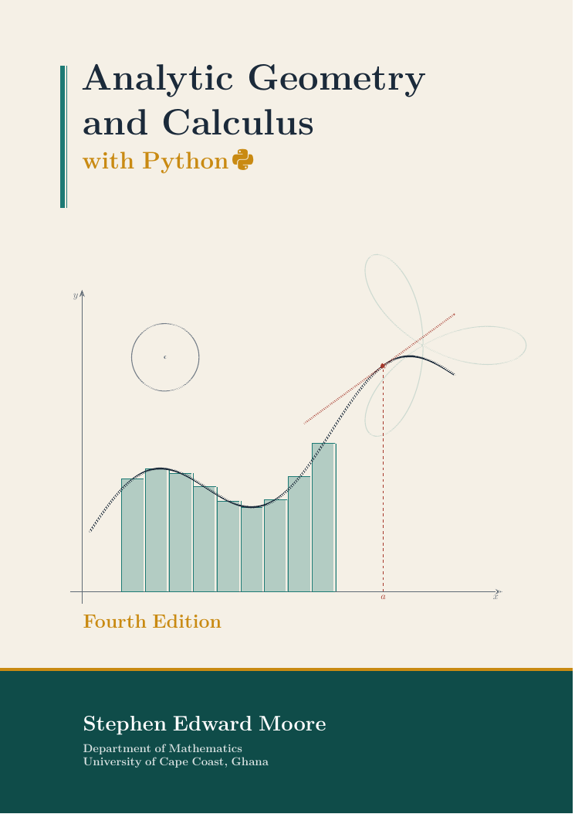

# Analytic Geometry and Calculus with Python

[](LICENSE-BOOK.md)
[](LICENSE)



**Fourth Edition (2026)** · Stephen E. Moore · Department of Mathematics, University of Cape Coast, Ghana

🌐 **Author's website:** [https://moorestephen.info/](https://moorestephen.info/)
📘 **Download the book (PDF):** [Analytic_Geometry_and_Calculus_with_Python_4th_Edition.pdf](Analytic_Geometry_and_Calculus_with_Python_4th_Edition.pdf)

This repository contains the book and all of its Python programs and Jupyter notebooks. It is
free for students and teachers to use, share and adapt.

## About the book

*Analytic Geometry and Calculus with Python* is a first-year university text. It covers
coordinate geometry, circles, limits and continuity, differentiation and its applications,
integration and its applications, parametric equations, polar coordinates and conic sections.
It also teaches students to **use Python to explore, check and apply the mathematics**.
No programming experience is assumed: Chapter 0 is a gentle introduction to Python.

Every Python listing in the book has been run. The output printed beneath it in the book is the
real output of the program in this repository.

Each chapter contains:

- **Learning objectives** and a **chapter summary**
- worked examples by hand and in Python (NumPy, SymPy, Matplotlib, SciPy)
- highlighted **Key Concept** boxes (the ideas you must remember)
- **Historical Notes** on how the ideas developed, including Africa's contribution, from the
  Rhind papyrus to Euclid, Hypatia and Ibn al-Haytham
- **In Context** boxes that apply the mathematics to real situations: ride-hailing trip
  times and fares, telecom masts, population growth, rainfall, farms, bridges, satellites
- **Watch Out** boxes on common mistakes, and **Check Your Understanding** questions
- exercises in three kinds, *Skills*, *Applications* and *Programming*, with answers to
  selected exercises in Appendix B

A **Chapter Map** at the front of the book shows how the chapters depend on each other and
suggests routes through the book for different courses.

## Contents and code

| Chapter | Code | Notebook | Programs |
|---|---|---|---|
| 0. A First Course in Python for Calculus | [`code/ch00`](code/ch00) | [Open in Colab](https://colab.research.google.com/github/moorekwesi/analytic-geometry-calculus-with-python/blob/main/notebooks/ch00.ipynb) | arithmetic, lists, loops, functions, NumPy, Matplotlib, SymPy |
| 1. Coordinate Geometry | [`code/ch01`](code/ch01) | [Open in Colab](https://colab.research.google.com/github/moorekwesi/analytic-geometry-calculus-with-python/blob/main/notebooks/ch01.ipynb) | distance, great-circle distance, midpoint, gradient, lines, angles, section formula, point–line distance, bisectors |
| 2. Circles | [`code/ch02`](code/ch02) | [Open in Colab](https://colab.research.google.com/github/moorekwesi/analytic-geometry-calculus-with-python/blob/main/notebooks/ch02.ipynb) | centre and radius, circle through three points, tangents, line–circle and circle–circle intersection, trilateration, Archimedes' π |
| 3. Limits and Continuity | [`code/ch03`](code/ch03) | [Open in Colab](https://colab.research.google.com/github/moorekwesi/analytic-geometry-calculus-with-python/blob/main/notebooks/ch03.ipynb) | numerical and symbolic limits, one-sided limits, the number *e*, squeeze theorem, discontinuities, bisection, ε–δ |
| 4. The Derivative | [`code/ch04`](code/ch04) | [Open in Colab](https://colab.research.google.com/github/moorekwesi/analytic-geometry-calculus-with-python/blob/main/notebooks/ch04.ipynb) | secants and tangents, first principles, rules, chain rule, implicit differentiation, population growth, numerical differentiation |
| 5. Applications of the Derivative | [`code/ch05`](code/ch05) | [Open in Colab](https://colab.research.google.com/github/moorekwesi/analytic-geometry-calculus-with-python/blob/main/notebooks/ch05.ipynb) | tangents and normals, related rates, best departure time for a trip, curve fitting, curve sketching, optimisation, Newton's method, l'Hôpital |
| 6. Integration | [`code/ch06`](code/ch06) | [Open in Colab](https://colab.research.google.com/github/moorekwesi/analytic-geometry-calculus-with-python/blob/main/notebooks/ch06.ipynb) | indefinite integrals, substitution, Riemann sums, the Fundamental Theorem, integration by parts, trapezium and Simpson's rules, `quad` |
| 7. Applications of Integration | [`code/ch07`](code/ch07) | [Open in Colab](https://colab.research.google.com/github/moorekwesi/analytic-geometry-calculus-with-python/blob/main/notebooks/ch07.ipynb) | area between curves, distance from speed data, rainfall, average value, volumes of revolution, arc length, survey areas, probability |
| 8. Parametric Equations and Polar Coordinates | [`code/ch08`](code/ch08) | [Open in Colab](https://colab.research.google.com/github/moorekwesi/analytic-geometry-calculus-with-python/blob/main/notebooks/ch08.ipynb) | parametric curves, projectiles, the cycloid, coordinate conversion, polar curves, polar slopes and areas |
| 9. Conic Sections | [`code/ch09`](code/ch09) | [Open in Colab](https://colab.research.google.com/github/moorekwesi/analytic-geometry-calculus-with-python/blob/main/notebooks/ch09.ipynb) | parabola, satellite dish, arch, ellipse, orbits, hyperbola, locating a lightning strike, classifying conics, eccentricity |

Appendix A of the book is a Python quick reference. The program
[`tools/check_answers.py`](tools/check_answers.py) recomputes the answers in Appendix B.

Each program `code/chNN/name.py` is **self-contained**. The file `code/chNN/name.out` next to it
contains the output printed in the book, so you can check your results against it.

## Getting started

You need Python 3 with NumPy, SymPy, Matplotlib and SciPy.

- **No installation (works on a phone):** click an **Open in Colab** link in the table above.
  Google Colab runs the notebook in your browser, and all the libraries are already installed.
  Run each cell with **Shift + Enter**.
- **On a laptop:** install [Anaconda](https://www.anaconda.com/download), which includes
  everything and works offline.
- **With pip:**

```bash
git clone https://github.com/moorekwesi/analytic-geometry-calculus-with-python.git
cd analytic-geometry-calculus-with-python
pip install -r requirements.txt
```

Run a single program, for example the best-departure-time problem from Chapter 5:

```bash
python code/ch05/ex5_03_bolt_travel_time.py
```

To run **every** program in the book, regenerating all outputs and saving all figures in
`figures/`:

```bash
python run_all.py          # all chapters
python run_all.py ch05     # only Chapter 5
```

## How to learn from this repository

1. Read a section of the book with the corresponding program or notebook open.
2. **Type the code in yourself** (or run it) and compare your output with the `.out` file.
3. **Change something:** a number, a function, a starting value. Predict what will happen
   first, then check.
4. Do the pen-and-paper exercises by hand first, then check them with Python.
5. Attempt at least one *Programming* exercise each week. Most of them start from one of these
   programs.

## Editions

| Edition | Year |
|---|---|
| First edition | 2019 |
| Second edition | 2021 |
| Third edition | 2024 |
| Fourth edition (*with Python*) | 2026 |

## Citing the book

> S. E. Moore, *Analytic Geometry and Calculus with Python*, 4th ed., Department of
> Mathematics, University of Cape Coast, Ghana, 2026.
> Available at https://github.com/moorekwesi/analytic-geometry-calculus-with-python

## Permissions and licence

You are free to use, share and adapt these materials for teaching, learning or any other
purpose, as long as you give credit to the author.

- **The book (course material)**,
  `Analytic_Geometry_and_Calculus_with_Python_4th_Edition.pdf`, is licensed under the
  [Creative Commons Attribution 4.0 International Licence (CC BY 4.0)](LICENSE-BOOK.md).
  You may copy, print, redistribute and adapt it, provided you credit the author, link to the
  licence and indicate any changes.
- **The Python code** (`code/`, `notebooks/`, `tools/` and `run_all.py`) is licensed under the
  [MIT Licence](LICENSE). You may use, copy, modify and distribute it freely, provided the
  copyright notice and licence text are kept.

Unless a source is given, the numerical data in the book's *In Context* boxes and in the
programs (fares, trip times, tariffs and similar figures) are illustrative and invented for
teaching.

## Author

**Stephen E. Moore**, Department of Mathematics, University of Cape Coast, Ghana
Website: [https://moorestephen.info/](https://moorestephen.info/)

Corrections and suggestions are welcome: please open an
[issue](https://github.com/moorekwesi/analytic-geometry-calculus-with-python/issues).
